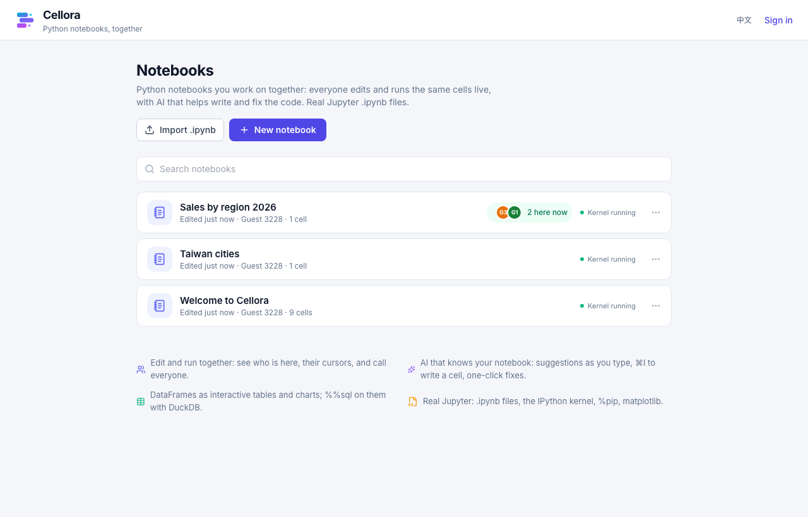
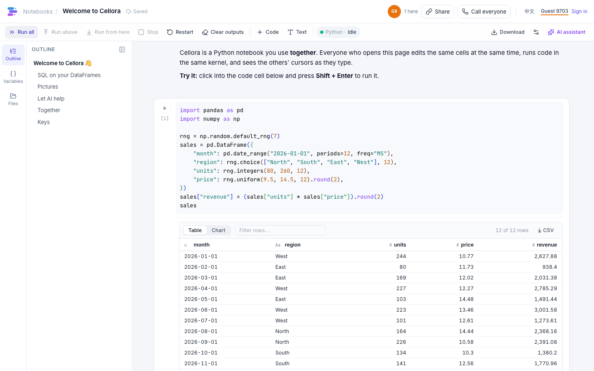
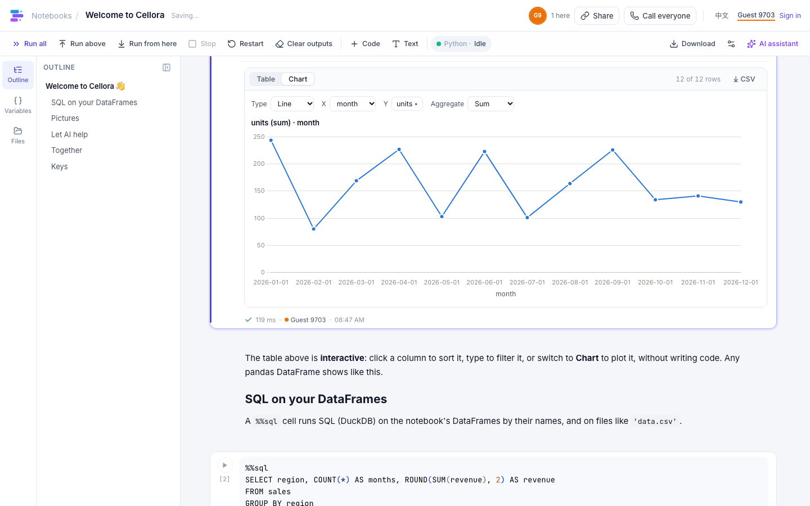
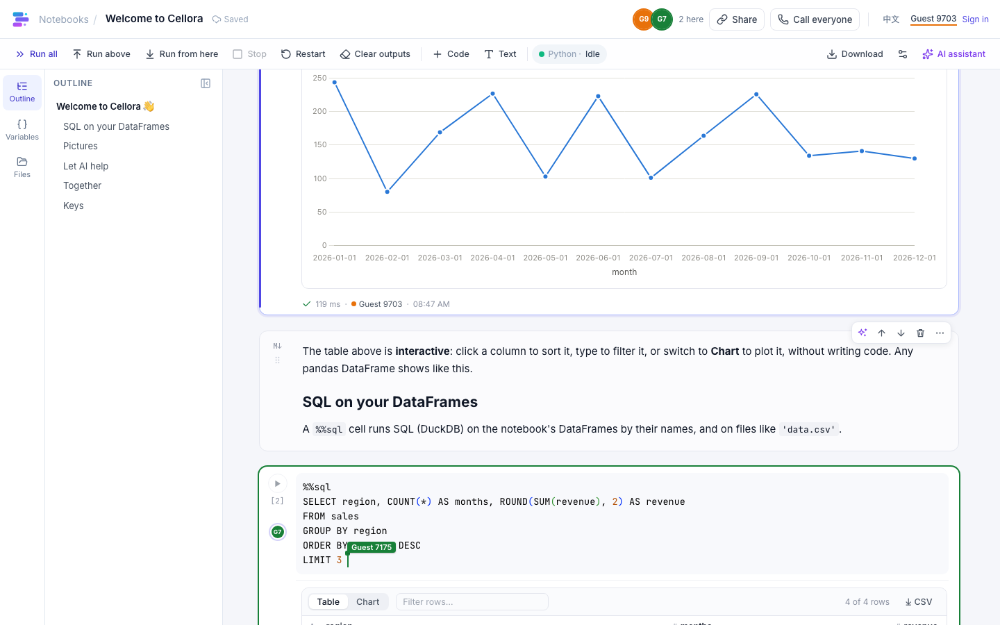
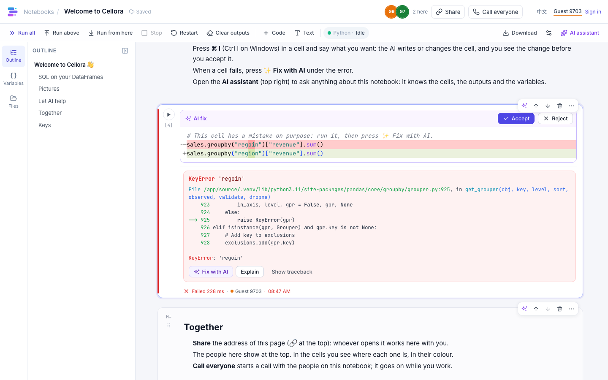
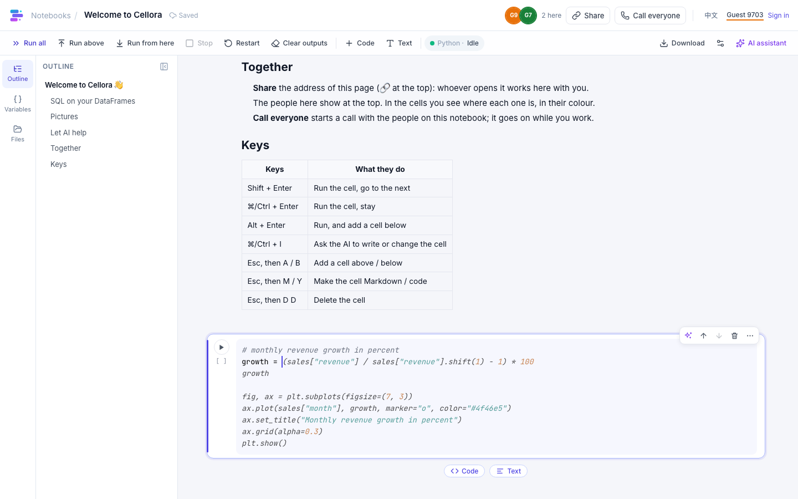
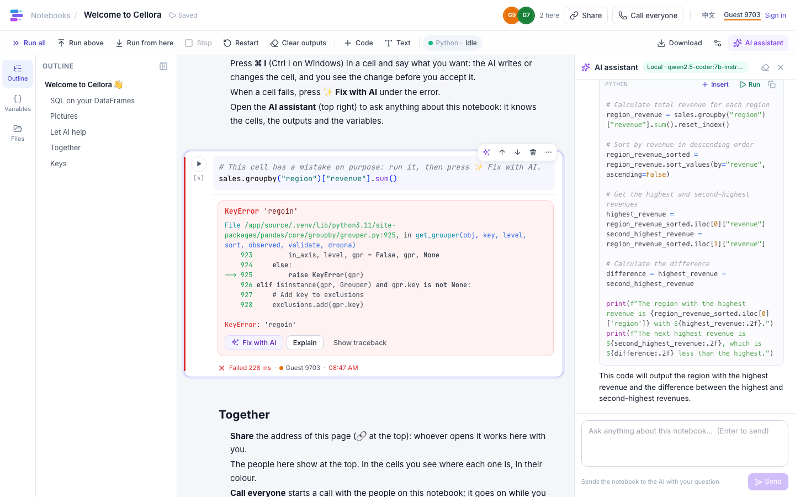
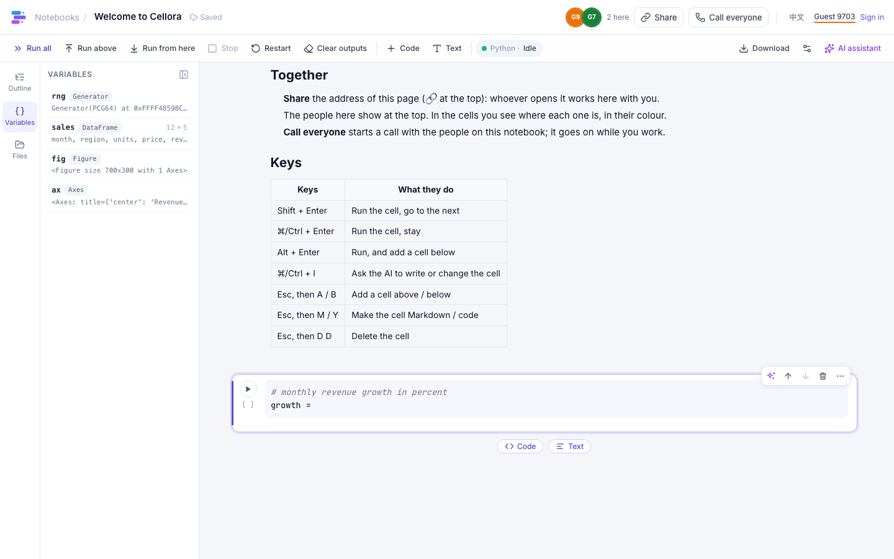
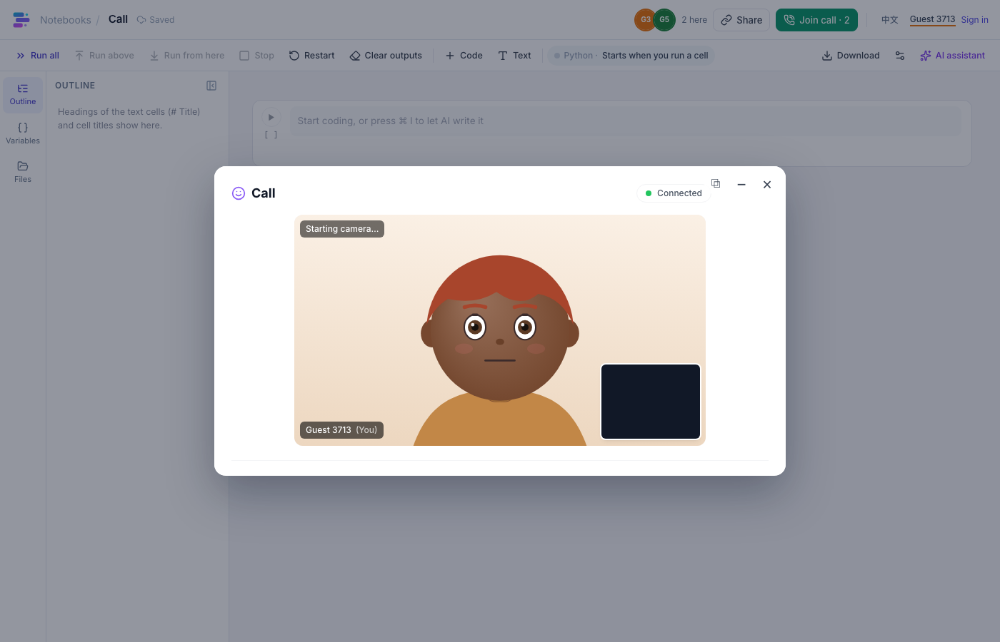

# Cellora 📒

A Python notebook that people use **together**, with the smarts of a Databricks notebook. Everyone who opens a notebook edits the same cells at the same moment (each with their own cursor, in their own colour), runs them in one shared kernel, sees who else is here, and can **call everyone** on the notebook. AI writes, completes, fixes and explains the code. Notebooks are plain Jupyter `.ipynb` files.

Built with [Reflex](https://reflex.dev/) for the [re-ddns](https://github.com/milochen0418/re_ddns) Agentic App Store: install it there and your team works at `https://cellora.reflex-ddns.com`. It also runs on its own.

## 📸 Interface Preview

| Notebooks, and who is on them | A notebook: code, Markdown, an interactive table |
|:---:|:---:|
|  |  |

| Charts from a DataFrame, no code | Editing together: their caret, their cell |
|:---:|:---:|
|  |  |

| ✨ Fix with AI: the change as a diff | ✨ Suggestions while you type (Tab takes them) |
|:---:|:---:|
|  |  |

| The AI assistant knows the notebook | Variables | Call everyone |
|:---:|:---:|:---:|
|  |  |  |

## 🌟 Features

**Together**
- **Live co-editing**: typing, adding, moving and deleting cells reaches everyone at once and merges with what the others do at the same moment (Yjs, the CRDT JupyterLab's own collaboration uses). Everyone's caret and selection show in their colour with a name tag, as on HackMD.
- **Who is here**: their faces at the top (click one to jump to the cell they are in), a dot in their colour on the cell each person is on, and a coloured ring around the cell someone is typing in. People who leave disappear at once (a closing tab says goodbye; a tab that stops answering is dropped after 30 s), with the same rules as ReflexGrid and DICOM Viewer.
- **One shared kernel**: what anyone runs, everyone's code sees. Runs wait in one queue; every cell says who ran it, when, and how long it took (`✓ 0.42 s · Ann · 10:23`).
- **Call everyone**: rings everyone on the notebook (Accept / Decline); the call runs in a call app of the App Store (Avatar, Audio or Video Call, through the DDNS Intent `call.join`) and keeps going while you work. Late comers see *Join call · 3*.
- **Share** a notebook by its address. Your undo takes back only your own typing.

**AI that knows your notebook**
- **Grey suggestions while you type** (Tab takes them), from the code before and after the cursor, the cells above, and the kernel's variables and DataFrame columns.
- **⌘I / Ctrl I**: say what you want, and the AI writes or rewrites the cell; you see the change as a diff and accept (⌘↵) or reject (Esc). Works for Markdown cells too.
- **✨ Fix with AI** under any error, and **Explain** for what went wrong.
- **The AI assistant** panel answers questions about the notebook (it sees the cells, their outputs and the variables); code in its answers can be inserted as a new cell or run at once. Your conversation is yours; what you insert, everyone sees.
- **Start with AI**: describe a notebook and the AI writes it (Markdown and code cells).
- On a re_ddns host with the [AI Hub](https://github.com/milochen0418/ai_hub), the hub's models answer: which one is set on the hub's page, for every app at once, and Cellora holds no key. The hub's page lists Cellora's three AI uses (the assistant; ⌘I, fixes and new notebooks; the suggestions while typing) from the moment it is installed, and the AI panel's badge shows which model answers each. Elsewhere, Claude when an Anthropic API key is set; otherwise a local model through Ollama (e.g. `qwen2.5-coder:7b`), so it works with no key and nothing leaves your machine.

**A smarter notebook**
- **DataFrames as interactive tables** (like Databricks' `display()`): sort, filter, download CSV, and switch to **Chart** (bar, line, area, scatter, pie, with aggregation) without writing code; the chart choice is saved with the notebook and shared.
- **`%%sql`**: SQL (DuckDB) over the notebook's DataFrames by their names and over files (`SELECT * FROM 'sales.csv'`); `%%sql result` keeps the answer.
- **The editor is Monaco** (VS Code's): the kernel's completions (Tab, after a dot) and docs on hover, multi-cursor, find and replace.
- **Jupyter's keys**: Shift+Enter, ⌘/Ctrl+Enter, Alt+Enter; Esc, then A / B (add), M / Y (Markdown / code), D D (delete), Z (bring a deleted cell back), arrows between cells; drag cells by their handle.
- **Outline** of the headings, **Variables** panel, **Files** panel (the kernels' working folder: upload a CSV, then *Use* adds a cell that reads it).
- Rich outputs: matplotlib (sharp on retina), HTML (in a sandboxed frame when it has scripts), Markdown, LaTeX, images, JSON; long outputs fold; progress bars rewrite their line; a flood of printing is cut at 1 MB.
- Run all, run above, run from here, Stop, Restart; a cell that fails stops the cells queued after it. Kernels start on the first run and stop when nobody has used them for an hour.
- **Real Jupyter files**: import any `.ipynb`, download `.ipynb` or `.py`; everything Cellora adds lives under `metadata.cellora`, which other tools ignore.
- Saved continuously (no Save button; ⌘S just says so). English and 繁體中文.

## 🆚 Compared with Jupyter and Databricks

| | Jupyter (Notebook / Lab) | Databricks notebook | Cellora |
|---|---|---|---|
| Editing together | JupyterLab with the `jupyter-collaboration` extension | yes | yes, built in: carets, cell markers, follow someone |
| Who is here | collaborators list (with the extension) | avatars | faces at the top, dots on cells, *N here now* on the list |
| Voice / video | no | no | **Call everyone** (App Store call apps) |
| AI | the `jupyter-ai` extension, set up separately | Databricks Assistant (cloud) | suggestions, ⌘I, Fix, Explain, assistant panel; Claude or a local model |
| `display(df)` table and charts | HTML table | interactive table + visualizations | interactive table + chart builder, shared |
| SQL cells | extensions (e.g. JupySQL) | `%sql` on Spark | `%%sql` on DataFrames and files (DuckDB) |
| File format | `.ipynb` | its own source format (imports / exports `.ipynb`) | `.ipynb` |
| Where it runs | your machine or server | Databricks' cloud | your machine, in the re-ddns App Store |

## 📐 How it works

```
Browser (each person)                                   Cellora server (Reflex backend)
 notebook.jsx: cells, Monaco editors, outputs ──Yjs──►  docs.py: one shared document per notebook
   typing, adding / moving / deleting cells   ◄─sync──  (pycrdt), saved as .ipynb 2 s after a change
                                              /_cellora/yjs/<id>
 Run, AI, panels ──────── Reflex events ─────────────►  kernels.py: one ipykernel per notebook,
 top bar, kernel state, variables, people ◄── NotebookRoom (SharedState) ──  a run queue; outputs and
                                                                            run status go into the
 grey suggestions, completions, docs ── POST /_cellora/inline, /complete, /inspect   shared document
                                                        ai.py: the AI Hub, Claude (API key) or Ollama
 Call everyone ── DDNS Intent call.join ──► a call app of the App Store (Avatar / Audio / Video Call)
```

- **The cells are a shared document.** Each open notebook is a Yjs document held by the server ([pycrdt](https://github.com/y-crdt/pycrdt)); every browser keeps a copy in sync over a WebSocket (the y-websocket protocol). The server is a peer that also writes the kernel's outputs and each cell's run status into it, so they reach everyone the same way, and it saves the document as `.ipynb`. When the server reads a notebook from its file again (after a restart, or when nobody had it open for a while), a tab that stayed open takes the server's document instead of merging its own copy into it (which would double every cell), and brings along what it typed meanwhile.
- **Everything else is Reflex.** The page around the cells, and the notebook's room (a `SharedState` every tab on the notebook links to): the title, the people, the kernel's state and queue, the variables, the call.
- **The kernel is Jupyter's own** (`ipykernel` through `jupyter_client`, local sockets), so `%pip`, `%timeit`, matplotlib and every Jupyter output work. It starts in the workspace folder (the Files panel). Cellora's helpers (the table format, `%%sql`, the variables summary) are installed by `cellora/kernel_boot.py` when it starts.

| File | Role |
|------|------|
| `assets/cellora/notebook.jsx` | The cells: rendering, editing, keys, drag and drop, people on cells, the AI prompt and diff, the outline. |
| `assets/cellora/ydoc.js` | The notebook's Y.Doc in the browser: the connection and the cell operations. |
| `assets/cellora/editor.js` | Monaco: kernel completions and docs, AI suggestions, the Yjs binding with everyone's carets, per-person undo. |
| `assets/cellora/outputs.jsx` | Outputs: text, errors, images, HTML, Markdown, LaTeX; the interactive table and its charts (Chart.js). |
| `cellora/docs.py` | The open notebooks' shared documents, their WebSocket, saving. The layout of the document is described at its top. |
| `cellora/kernels.py`, `kernel_boot.py` | Kernels, the run queue, outputs into the document; what every kernel runs at start. |
| `cellora/ai.py`, `context.py` | The AI providers and prompts; what the AI is told about a notebook. |
| `cellora/store.py`, `nbfile.py` | Where notebooks are kept (files, or the `notebooks` collection); the `.ipynb` format. |
| `cellora/viewers.py`, `call.py`, `rooms.py` | Who is here, Call everyone, pushing changes to the notebook's room. |
| `cellora/states/`, `cellora/components/` | The Reflex states and pages. |

## 🚀 Install on re-ddns (Agentic App Store)

The App Store catalog (`re_ddns/data/appstore_catalog.json`) has an entry for this app:

```json
{
  "id": "cellora",
  "subdomain": "cellora",
  "github_repo": "https://github.com/milochen0418/cellora.git",
  "app_name": "cellora",
  "volumes": ["smart-app-cellora-data:/root/.local/share/cellora"],
  "storage": [{"collection": "notebooks", "access": "contribute"}]
}
```

1. Open `https://aapps.reflex-ddns.com` and install **Cellora**. Every setting is optional (see below).
2. Open `https://cellora.reflex-ddns.com`, take the getting-started tour, and share a notebook's address.

On re-ddns each notebook is an item of the shared collection `notebooks` (`notebook.ipynb`, kind `notebook.jupyter`): other apps given the collection can read the notebooks, and the App Store's storage page lists them. The workspace files live in the `smart-app-cellora-data` volume. For *Call everyone*, install one of the call apps (Avatar Call, Audio Call or Video Call).

## 💻 Run locally

Prerequisites: Python 3.11 and [Poetry](https://python-poetry.org/docs/#installation). `reflex_ddns_auth` is expected next to this checkout (`../reflex_ddns_auth`), as for the other apps of the App Store.

```bash
poetry env use python3.11
poetry install
poetry run ./reflex_rerun.sh
```

Open `http://localhost:3000`. For AI without a key, run [Ollama](https://ollama.com) with a coding model: `ollama pull qwen2.5-coder:7b`.

> Other apps on this machine may own ports 3000/8000. Then: `REFLEX_API_URL=http://localhost:8150 poetry run reflex run --frontend-port 3150 --backend-port 8150`.

## ⚙️ Configuration (all optional)

| Variable | Default | Purpose |
|----------|---------|---------|
| `ANTHROPIC_API_KEY` | *(empty)* | With a key, the AI is Claude. |
| `CELLORA_CLAUDE_MODEL` | `claude-opus-5-5` | The Claude model (all the AI features use it; suggestions at low effort). |
| `OLLAMA_URL` | `http://host.docker.internal:11434` in a container, else `http://localhost:11434` | Ollama, used when there is no Anthropic key. |
| `OLLAMA_MODEL` | a pulled model with "coder" in its name, else the first | The Ollama model. |
| `CELLORA_AI_PROVIDER` | `auto` | `hub`, `claude`, `ollama` or `off`; `auto` takes the AI Hub when there is one, else Claude with a key, else Ollama. |
| `DDNS_AI_HUB_URL` | *(found through re-ddns)* | The AI Hub's backend when Cellora runs outside the platform (e.g. `http://localhost:8100`; `DDNS_AUTH_SECRET` and `SERVICE_SUBDOMAIN` as the platform sets them). |
| `CELLORA_RUN_PASSCODE` | *(empty)* | Running code asks for it once per tab (reading and editing don't). |
| `CELLORA_HOME` | `~/Library/Application Support/cellora` (macOS), `~/.local/share/cellora` (Linux) | Notebooks (when not in a collection), the workspace, the kernels' files. |
| `CELLORA_FILES_DIR` | `$CELLORA_HOME/files` | The workspace: the kernels' working folder, the Files panel. |
| `CELLORA_MAX_KERNELS` | `6` | Kernels running at once; the one unused longest stops first. |
| `CELLORA_KERNEL_IDLE_MINUTES` | `60` | A kernel nobody used for this long, with nobody on its notebook, stops. |
| `CELLORA_NOTEBOOK_IDLE_MINUTES` | `10` | A notebook nobody has open for this long is saved and closed; the next person to open it reads it from its file. |
| `CELLORA_CALL_APP` | *(chosen by the caller)* | The call app for every call (e.g. `avatar-chat`). |

## 🔒 What to know about safety

- **A notebook runs Python in Cellora's container**, with what the container can reach. On re-ddns that is fine on your own network; if others use it, set `CELLORA_RUN_PASSCODE`. In a dev-mode install (`dev-install`), the container also mounts your checkout read-write.
- The kernel doesn't get the app's secrets in its environment (API keys, passcodes, `DDNS_AUTH_SECRET`), but code running as the same user can still find them in the container: treat everyone who can run code as able to read `ANTHROPIC_API_KEY`.
- With Claude, every AI request sends the relevant part of the notebook (cells, outputs, variables) to Anthropic. With Ollama, nothing leaves your machines. Through the AI Hub, that depends on the model each role is set to on the hub's page.
- HTML outputs with scripts run in a sandboxed frame without access to the page.

## 🧪 Tests

```bash
poetry run pytest                              # 24 unit tests: documents, kernels, store, .ipynb, AI, context
poetry run playwright install chromium         # first time only
poetry run ./run_test_suite.sh smoke_home      # E2E suites: see testcases/README.md
```

Suites: `smoke_home`, `collab_live`, `run_cells`, `files_vars`, `reconnect_reload` (needs `CELLORA_NOTEBOOK_IDLE_MINUTES=0.05`), `ai_assist` (needs Claude or Ollama), `passcode` (needs `CELLORA_RUN_PASSCODE`), `call_everyone` (needs a call app; run it against re-ddns). The Claude request is checked in the unit tests against a mocked API, so no key is needed.

## 🩺 Troubleshooting

- **The AI panel says "Not set up"**: no AI Hub (or none of its models answers the `smart` role), no Anthropic key, and Ollama didn't answer or has no model. In a container Ollama is reached at `host.docker.internal:11434`; press *Check again* after `ollama pull qwen2.5-coder:7b`.
- **A cell waits with "Waiting for the kernel to start…"**: the first run starts the notebook's kernel (a few seconds; the first matplotlib plot of a new install builds its font cache).
- **The kernel shows "Stopped"**: it crashed or ran out of memory; *Restart* in the toolbar.
- **A dev-mode install restarts the server on every file change** in the checkout (screenshots under `testcases/` or `docs/` too): kernels and the notebooks' memory start over (notebooks are saved first). Keep test output outside the checkout (`OUTPUT_DIR=...`).

## 📄 License

[MIT](LICENSE)
